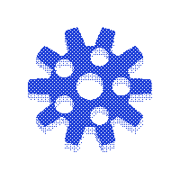
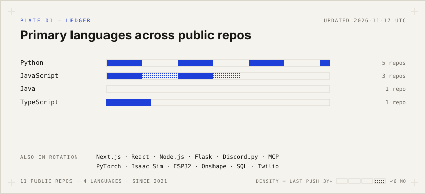

<picture>
  <source media="(prefers-color-scheme: dark)" srcset="./assets/gear-dark.gif">
  
</picture>

# Shrey Shah

**Computer Science · University of Washington, Seattle** Minors in Entrepreneurship & Applied Math · Previously AI Engineering Intern @ GoDaddy

[Website](https://shreys.me) · [Insights](https://shreys.me/insights/) · [CV](https://shreys.me/more/) · [LinkedIn](https://www.linkedin.com/in/shreyshah0211/)

## Now & recently

- **UW Robot Learning Lab · Sep 2026–now:** Training PPO policies in Isaac Sim/Lab for autonomous drift parking on a scale car, with sim-to-real domain randomization.
- **UW BioRobotics Lab · Sep 2026–now:** Building the photonic sensing subsystem for TPT-Finder, an NSF-funded surgical pen: photodiode amplifiers, ESP32 acquisition, Python signal processing.
- **GoDaddy · Jun–Sep 2026:** Built an MCP-powered transaction and refund lookup tool for GoDaddy Payments. Projected to save $560k a year.
- **Redmond Code Association · 2022–2026:** Founded and led a nonprofit: 40+ volunteers, 6.5k+ students taught, 3+ tons of e-waste collected. Featured in [The Seattle Times](https://www.seattletimes.com/education-lab/with-few-coding-classes-at-school-redmond-teens-teach-their-own/) and [425 Business 40 Under 40](https://www.425business.com/profiles/425-business-40-under-40-2024/article_d5f1ff4e-6499-11ef-bac9-2bdee52767a4.html).

<b>Earlier experience</b>

- **University of Washington · Summer 2025:** Teaching assistant for the Robinson Center Intro to Python course.
- **iCode · 2024–2025:** Programming instructor. Built a [Slack attendance bot](https://github.com/shreyshah0211/Slack-Attendance-Bot) to streamline check-ins.
- **Soft-robotics research · 2024–2025:** Earthworm-inspired burrowing robot. 2nd at WSSEF 2024, Robotics I.
- **FIRST Robotics, Sushi Squad 7461 · 2021–2024:** Programming team; Galileo Division semi-finalists at Worlds 2023.
- **Altruist Accelerator · Summer 2024** and **Cledge · 2022–2023:** Business analysis and software engineering internships.

## Selected work

| Project | What it does | Built with |
| :--- | :--- | :--- |
| [Cue](https://www.speakwithcue.com/) | AI public-speaking coach with live feedback through custom smart glasses. 2026 Lavin Showcase winner. | Node.js, NLP, real-time A/V |
| [Sutra](https://github.com/shreyshah0211/Sutra) · [GeekWire](https://www.geekwire.com/2025/drone-startup-surveying-power-lines-to-prevent-fires-wins-top-prize-at-prestigious-uw-competition/) | Medical training through realistic patient simulations. Dempsey Startup Competition Sweet 16. | Python, Flask, OpenAI |
| [cookinUp](https://github.com/shreyshah0211/cookinUp) · [Devpost](https://devpost.com/software/cookinup) | A pixel-art kitchen that visualizes multi-agent AI, with live token costs. Built at DubHacks 2026. | Next.js, TypeScript, Claude API |
| [Vera](https://github.com/shreyshah0211/Vera) | AI assistant that makes phone calls for you and sends a transcript after. | Python, Twilio, ElevenLabs |
| [Lock In](https://github.com/shreyshah0211/lock-in) | Social gym-streak app: post a gym photo every 48 hours to keep your streak. | JavaScript |

<b>More projects</b>

- [EXABYTE](https://github.com/shreyshah0211/EXABYTE): Discord bot, 4k+ lines, served 70+ servers and 20k+ users.
- [Sushi Crawls](https://github.com/shreyshah0211/Sushi-Crawls): FRC analytics dashboard on Blue Alliance data.
- [MMT Discord Bot](https://github.com/shreyshah0211/MMT-Discord-Bot): Helped competitors navigate the Mustang Math Tournament online.
- [USACO Prep](https://github.com/shreyshah0211/USACO-Prep): USACO Silver practice solutions in Java.
- **Electric longboard:** Built the deck from scratch, then wired in hub motors, an ESC and a battery pack.

Other recognition: DECA International Finalist (3× ICDC) · FIRST Worlds 2023 · 2× AIME qualifier · Presidential Volunteer Service Award Gold ×2 · CodeDay World Champions 2023.

## What I build with

Python · TypeScript · JavaScript · Java · SQL 
Next.js · React · Node.js · Flask · PyTorch · Isaac Sim 
ESP32 · Onshape · OpenAI / Claude APIs · MCP

<picture>
  <source media="(prefers-color-scheme: dark)" srcset="./assets/stats-dark.svg">
  
</picture>

Counts repositories by primary language, not bytes or proficiency. HTML, CSS, and SCSS excluded. Refreshed weekly by [`scripts/build-stats.mjs`](./scripts/build-stats.mjs) from the GitHub API.

---

Profile updated November 16, 2026 · [shreys.me](https://shreys.me)
