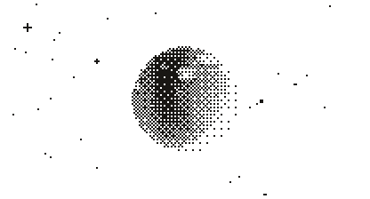

<picture>
  <source media="(prefers-color-scheme: dark)" srcset="./assets/sky-dark.gif">
  
</picture>

# Shrey Shah

**Computer Science · University of Washington, Seattle**

[Website](https://shreys.me) · [Insights](https://shreys.me/insights/) · [LinkedIn](https://www.linkedin.com/in/shreyshah0211/)

---

Profile updated November 17, 2026 · [shreys.me](https://shreys.me)
